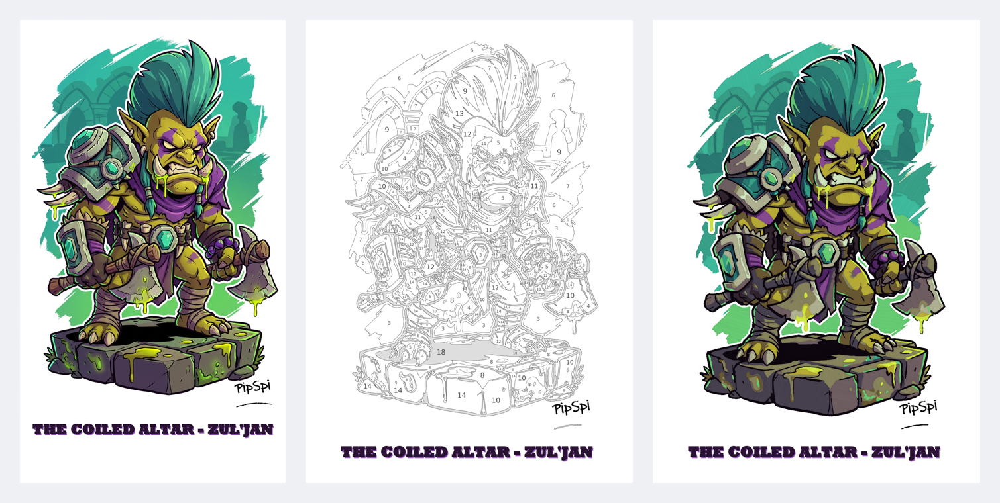
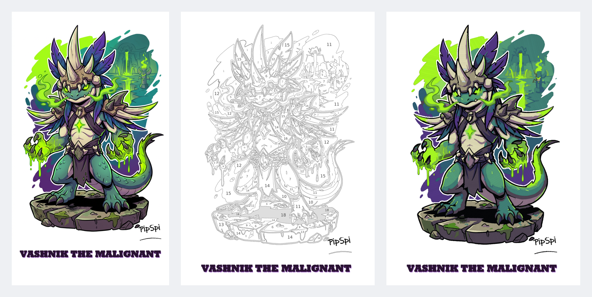

# Paint by Numbers kit generator

Turn an illustration into a printable paint-by-numbers kit for markers:

- a **two-page A4 sheet**: page 1 is the numbered drawing, as large as the page allows; page 2 is the colour legend and the painting instructions;
- a **vector PDF** (real text with embedded fonts, vector zones and outlines) plus PNG pages at 300 dpi;
- a **marker demo**: the sheet coloured the way a person would do it with markers;
- an interactive **step-by-step HTML guide**: one step per colour, with a checkbox to see the drawing fill in and the areas of the current colour highlighted.





Artwork and signature: PipSpi. The examples are the eight bosses of the World of Warcraft raid *Venomous Abyss*.

## What it does

- **Picks the number of colours automatically.** It scans 6 to 16 colours in CIELAB and keeps the smallest count that renders the image faithfully, as long as every pair of colours stays clearly distinguishable (CIEDE2000 ≥ 9). It then adds up to 2 accent colours for small but important details that no base colour renders, such as glowing eyes. In practice this gives 12 to 18 colours.
- **Keeps the details.** Eyes, teeth, mouths and highlights that contrast with their surroundings stay as their own areas. Slivers too thin to colour with a marker (under about 0.8 mm) merge into the neighbouring area.
- **Numbers colours from lightest (1) to darkest.** Paint in that order.
- **Makes the numbers readable but easy to cover.** The smallest number is about 1.7 mm tall. On light colours the numbers are smaller and paler, so a light marker covers them. Areas too narrow for a readable number have none on paper and are circled in the HTML guide.
- **Treats white as paper.** White areas have no number and no legend entry. Areas of the darkest colour (usually the outlines) are printed in mid grey, so eyes, mouths and other line details stay readable.
- **Keeps printed text.** The title band at the bottom and the artist's signature are detected and printed in their original colours. They get no zones or numbers.
- **Crops white margins** so the drawing fills page 1.

## How to colour with markers

Printed on page 2 of every sheet:

1. Work from colour 1 (lightest) to the darkest colour, one colour at a time.
2. For each area, first trace its outline with the marker tip, just inside the printed line.
3. Then fill it with straight, parallel strokes in one direction, each stroke slightly overlapping the last.
4. Keep a light, even pressure and do not go back over ink that is already dry: that leaves streaks.
5. Let light colours dry before painting the dark colours next to them.

## Usage

```bash
pip install -r requirements.txt
bash make_sheet.sh path/to/image.png out
```

This writes `out/<image name>/` with:

| File | What it is |
|---|---|
| `*_paint_by_numbers_A4.pdf` | 2-page vector PDF, ready to print |
| `*_paint_by_numbers_A4_p1_drawing.png` | page 1 at 300 dpi |
| `*_paint_by_numbers_A4_p2_legend.png` | page 2 at 300 dpi |
| `*_paint_by_numbers_A4_p1_drawing.svg` | page 1 as SVG |
| `*_vettoriale_colori.svg` | the drawing in flat colours, vector |
| `*_demo_A4.png` | marker demo |
| `*_step_by_step.html` | step-by-step guide; open it in any browser, it works offline |
| `colours.txt` | the colour-count scan and why that number was chosen |

The title comes from the file name: `35_The_Coiled_Altar___Zul_jan.png` becomes "The Coiled Altar – Zul'jan". A leading number is dropped, `___` becomes a dash, and `_` before a lowercase word becomes an apostrophe. Set `PBN_NOME` to override it.

Fonts default to DejaVu Sans at `/usr/share/fonts/truetype/dejavu/`. Point `PBN_FONT` and `PBN_FONT_BOLD` at other `.ttf` files if needed.

### Tuning

| Variable | Default | Effect |
|---|---|---|
| `PBN_MAX_ACC` | 2 | maximum accent colours added to the base palette |
| `PBN_ACCENTI` | 1 | set to 0 to disable accent colours |
| `PBN_DET_DE` | 16 | contrast (CIEDE2000) that makes a small area a detail worth keeping |
| `PBN_MIN_DET` | 90 | minimum size in pixels of a kept detail |
| `PBN_DET_R` | 5 | minimum half-width in pixels of a kept detail (thinner slivers merge) |

## The scripts

All scripts live in `pbn/` and write into the current folder. `make_sheet.sh` runs them in order. Code comments are in Italian.

| Script | Step |
|---|---|
| `0_consiglia_colori.py` | scans colour counts and recommends one |
| `1_quantizza.py` | crops margins, detects the printed name and signature, builds the palette and the zones |
| `2_tavola_png_pdf.py` | PNG pages |
| `3_vettoriali.py` | vector PDF and SVG |
| `6_demo_pennarello.py` | marker demo (style spec in `stile_demo.md`) |
| `7_guida_passo_passo.py` | step-by-step HTML guide |
| `pbn_common.py` | page layout, number placement, instructions text |

## Examples: Venomous Abyss

Each folder in `examples/venomous-abyss/` holds the original illustration and the full kit: the PDF, both pages, the marker demo and the HTML guide. The guide links open the interactive page in your browser; you can also download `step_by_step.html` and open it offline.

| Boss | Colours | Kit |
|---|---|---|
| Nek'zali the Soulcoiler | 14 | [PDF](examples/venomous-abyss/nek_zali_the_soulcoiler/paint_by_numbers_A4.pdf) · [guide](https://raw.githack.com/PipSpinell/paint-by-numbers/main/examples/venomous-abyss/nek_zali_the_soulcoiler/step_by_step.html) · [demo](examples/venomous-abyss/nek_zali_the_soulcoiler/marker_demo.png) |
| The Twin Fangs | 18 | [PDF](examples/venomous-abyss/the_twin_fangs/paint_by_numbers_A4.pdf) · [guide](https://raw.githack.com/PipSpinell/paint-by-numbers/main/examples/venomous-abyss/the_twin_fangs/step_by_step.html) · [demo](examples/venomous-abyss/the_twin_fangs/marker_demo.png) |
| Entombed Wardens | 14 | [PDF](examples/venomous-abyss/entombed_wardens/paint_by_numbers_A4.pdf) · [guide](https://raw.githack.com/PipSpinell/paint-by-numbers/main/examples/venomous-abyss/entombed_wardens/step_by_step.html) · [demo](examples/venomous-abyss/entombed_wardens/marker_demo.png) |
| Vashnik the Malignant | 18 | [PDF](examples/venomous-abyss/vashnik_the_malignant/paint_by_numbers_A4.pdf) · [guide](https://raw.githack.com/PipSpinell/paint-by-numbers/main/examples/venomous-abyss/vashnik_the_malignant/step_by_step.html) · [demo](examples/venomous-abyss/vashnik_the_malignant/marker_demo.png) |
| Mor'zahi – Lost Expedition | 18 | [PDF](examples/venomous-abyss/mor_zahi_lost_expedition/paint_by_numbers_A4.pdf) · [guide](https://raw.githack.com/PipSpinell/paint-by-numbers/main/examples/venomous-abyss/mor_zahi_lost_expedition/step_by_step.html) · [demo](examples/venomous-abyss/mor_zahi_lost_expedition/marker_demo.png) |
| Sszorak | 17 | [PDF](examples/venomous-abyss/sszorak/paint_by_numbers_A4.pdf) · [guide](https://raw.githack.com/PipSpinell/paint-by-numbers/main/examples/venomous-abyss/sszorak/step_by_step.html) · [demo](examples/venomous-abyss/sszorak/marker_demo.png) |
| The Coiled Altar – Zul'jan | 18 | [PDF](examples/venomous-abyss/the_coiled_altar_zul_jan/paint_by_numbers_A4.pdf) · [guide](https://raw.githack.com/PipSpinell/paint-by-numbers/main/examples/venomous-abyss/the_coiled_altar_zul_jan/step_by_step.html) · [demo](examples/venomous-abyss/the_coiled_altar_zul_jan/marker_demo.png) |
| Ula'tek | 18 | [PDF](examples/venomous-abyss/ula_tek/paint_by_numbers_A4.pdf) · [guide](https://raw.githack.com/PipSpinell/paint-by-numbers/main/examples/venomous-abyss/ula_tek/step_by_step.html) · [demo](examples/venomous-abyss/ula_tek/marker_demo.png) |

## Support

If you like the kits, you can support PipSpi on Ko-fi: https://ko-fi.com/pipspi

## Licence

The code is released under the MIT licence (see `LICENSE`). The artwork in `examples/` is © PipSpi and is not covered by the code licence.
